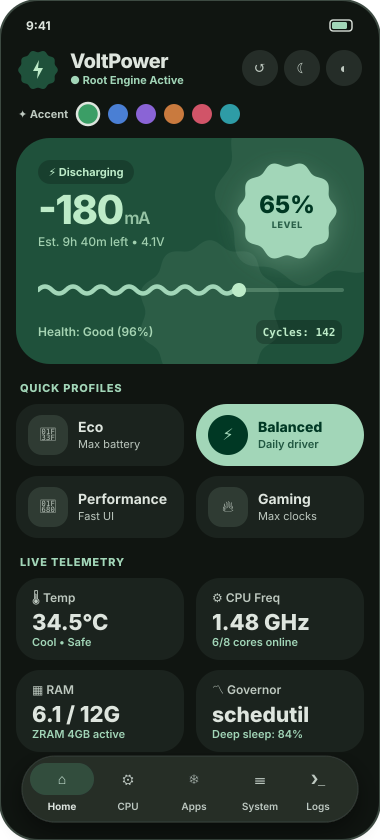
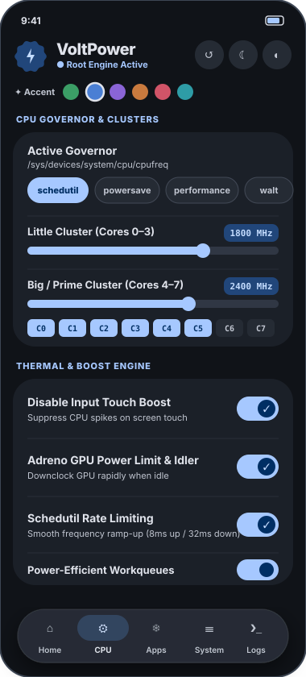
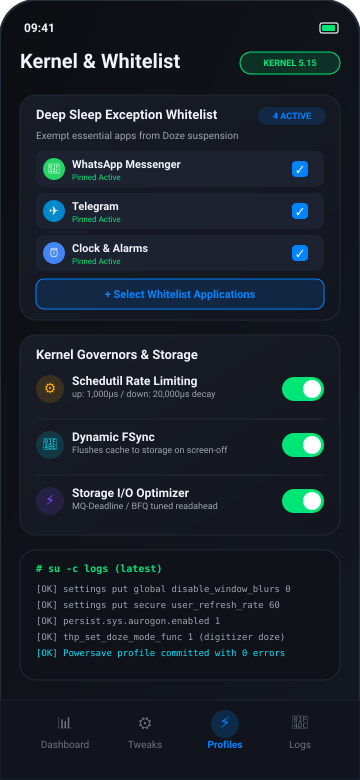

# VoltPower ⚡

> **Modern Kernel, Battery & HyperOS Super Power Saving Engine for Android**  
> Engineered with MIUIX design principles, root-level sysfs/settings controls, and intelligent power management.

---

## 📱 Screenshots

  <table>
    <thead>
      <tr>
        <th align="center">Dashboard &amp; Telemetry</th>
        <th align="center">HyperOS Power Saver</th>
        <th align="center">Kernel &amp; Whitelist</th>
      </tr>
    </thead>
    <tbody>
      <tr>
        <td align="center">
          
        </td>
        <td align="center">
          
        </td>
        <td align="center">
          
        </td>
      </tr>
    </tbody>
  </table>

---

## ⚡ Features Overview

### 🔋 HyperOS Super Power Saving Engine
- **Universal Refresh Rate Sync**: Flawlessly sets and locks display refresh rate (**60 Hz**, **90 Hz**, **120 Hz**, or **Dynamic**) across both `secure` and `system` tables (`user_refresh_rate`, `miui_refresh_rate`, `peak_refresh_rate`, `min_refresh_rate`), ensuring 60 Hz applies immediately on HyperOS and MIUI without clamping back to 90 Hz.
- **Control Center Blur Toggle**:
  - **Enable**: `su -c 'settings put global disable_window_blurs 0'` (restores real-time Gaussian blurs on Control Center & shade).
  - **Disable**: `su -c 'settings put global disable_window_blurs 1'` (cuts GPU render overhead for extended battery runtime).
- **Xiaomi THP Touch Doze Mode**: Engages Touch Host Processing (`thp_set_doze_mode_func 1`) to eliminate touchscreen digitizer idle power drain while asleep.
- **Touch Boost Clamping**: Prevents excessive 2.0 GHz+ CPU spikes on touch events (`msm_performance/parameters/touchboost 0`, `input_boost_freq 0`).
- **Aurogon Background Freezer**: Harnesses HyperOS native task suspension (`persist.sys.aurogon.enabled 1`, `persist.sys.spc.enabled 1`) with cgroup v2 freezing.
- **5G SA/NSA Radio Power Optimization**: Autonomous modem radio sleep (`persist.vendor.radio.5g_power_save 1`).
- **Preserve Light Theme**: Keeps light mode active while running battery saving without forced system-wide dark mode inversions.
- **Disable Background Scanning**: Throttles Wi-Fi and Bluetooth background location polling (`ble_scan_always_enabled 0`, `wifi_scan_always_enabled 0`).
- **Deep Sleep on Screen-Off**: Triggers instant `deviceidle force-idle` when the display turns off.

### 🛡️ Deep Sleep App Exception Whitelist
- **Instant Doze Exemption**: Add messaging apps, alarm clocks, or music players to `dumpsys deviceidle whitelist` so notifications arrive on time.
- **Prioritized App Sorting**: Selected and whitelisted packages are pinned to the top of the app picker for quick reviewing and unchecking.

### ⚙️ Kernel, CPU & Memory Controls
- **Schedutil Rate Limiting**: Fine-tunes `up_rate_limit_us` (1,000 µs) and `down_rate_limit_us` (20,000 µs) to prevent erratic governor ramp-ups.
- **Dynamic FSync**: Buffers write cache in memory during active screen time and flushes to storage on screen-off.
- **Storage I/O Scheduler**: Optimizes queue depths, readahead buffers, and scheduler policies (BFQ, Kyber, MQ-Deadline).
- **Memory & Swap Tuning**: Configures ZRAM compression ratios and LowMemoryKiller (LMK) minfree watermarks.

### 📊 Real-Time Telemetry & Profiles
- **Live Battery Gauges**: Accurate charging wattage, thermal temperatures, battery health, and millivolt status.
- **Per-Core CPU Clocks**: Real-time frequencies for Little, Mid, and Prime cores.
- **Profile Presets**: Switch instantly between **Powersave**, **Balanced**, **Performance**, and **Custom**.
- **Live Root Execution Logs**: Real-time terminal output with zero-overhead root execution.

---

## 🛠️ Root Requirements

VoltPower operates via standard root access (`su`):
- Supported managers: **Magisk**, **KernelSU**, and **APatch**.
- Seamless execution with graceful non-root fallback for telemetry monitoring.
